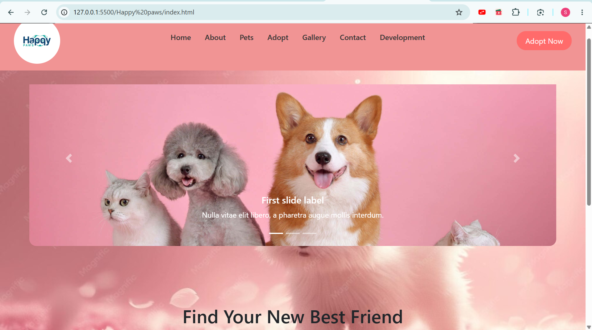
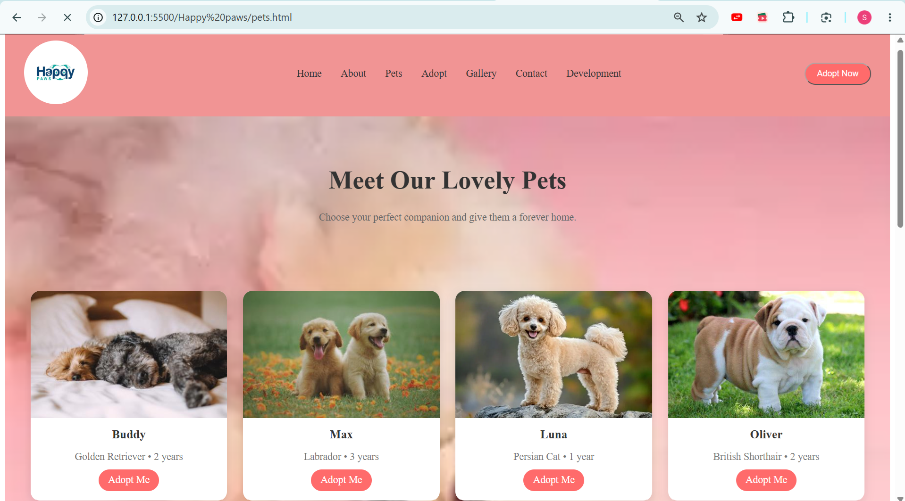
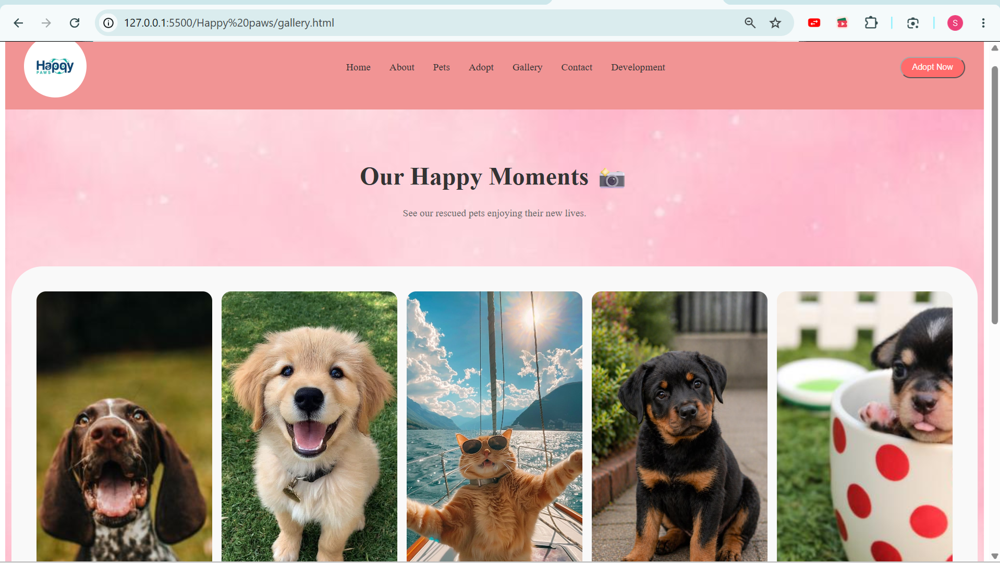

# Happy Paws – Pet Adoption Website

Happy Paws is a user-friendly pet adoption website designed to help people explore pets and find their perfect companions.

## Project Description

This website provides a simple platform for browsing pets, viewing their details, exploring pet galleries, and filling out adoption forms. The project aims to promote pet adoption through an attractive and easy-to-use interface.

## Technologies Used

- HTML5
- CSS3
- Visual Studio Code
- GitHub

## Key Features

- Attractive homepage with an image carousel
- Pet listings with breed and age details
- Pet adoption form
- Pet photo gallery
- About and Contact pages
- Adoption confirmation pages
- Simple navigation interface

## Project Screenshots

### Homepage

### Available Pets

### Pet Gallery

## How to Run

1. Download or clone the repository.
2. Open the project folder in Visual Studio Code.
3. Open index.html using Live Server.
4. Explore the website in your browser.

## Project Purpose

The purpose of this project is to encourage pet adoption and demonstrate frontend web development skills through a pet adoption website.
